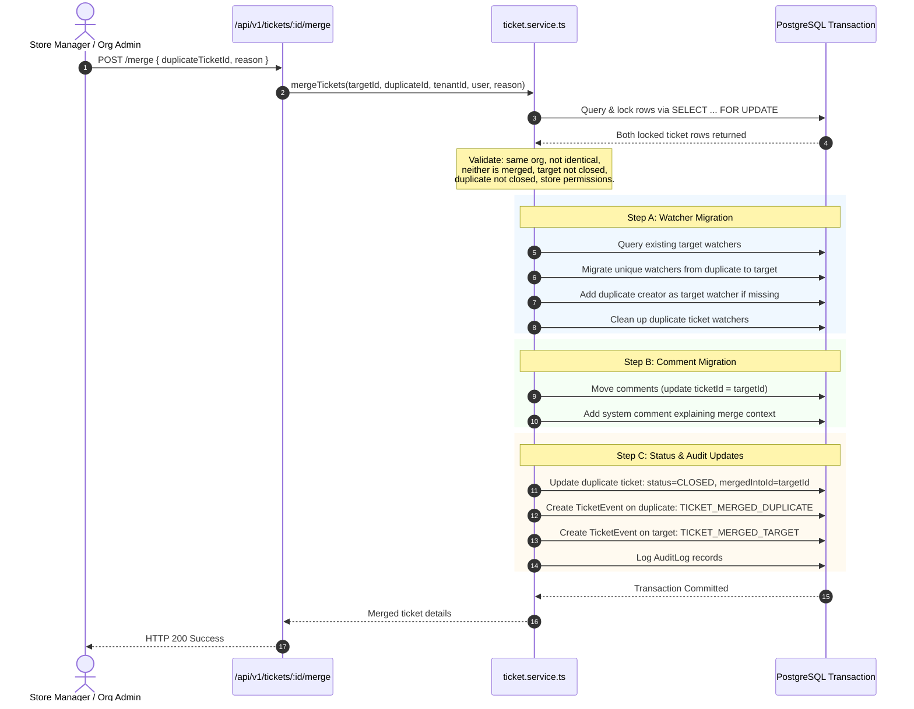
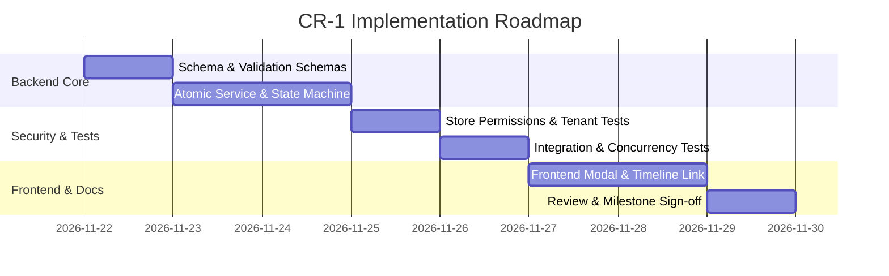

# Change Request Impact Estimate & Implementation Plan
## CR-1: Merge Duplicate Tickets

**Document Version:** 1.0  
**Date:** 21 November 2026  
**Project:** DeskOps – Facility Management & Maintenance Service Desk  
**Target Milestone:** Phase 1 / Week 3  
**Author:** Senior Backend Engineer & Software Architect  
**Status:** Under Technical Review  

---

## 1. Executive Summary & Business Requirement

### 1.1 Business Context
In multi-tenant facility management operations, multiple residents, tenants, or staff members frequently report identical physical maintenance defects (e.g., several occupants in a residential tower independently reporting a leaking boiler or a faulty elevator). 

Without ticket deduplication:
- Multiple technicians can be dispatched to inspect the exact same issue, wasting labor and operational budget.
- Communications, diagnostic findings, and vendor quotes become fragmented across multiple disconnected tickets.
- Performance analytics and SLA response/resolution metrics are artificially skewed with duplicate incidents.

### 1.2 Client Requirement Specifications
When two tickets represent the same maintenance problem:
1. **Primary vs. Duplicate:** One ticket must remain the active, authoritative "primary/original" ticket.
2. **Duplicate Closure:** The duplicate ticket must be automatically closed and marked as merged.
3. **Comment Consolidation:** All public and internal comments from the duplicate ticket must move to the original ticket, preserving authorship, message bodies, and original creation timestamps.
4. **Watcher Consolidation:** All watchers (subscribers) from the duplicate ticket must be consolidated into the original ticket without duplicate subscription violations.
5. **Traceable Auditability:** An indelible, bidirectional audit trail must link the original and duplicate tickets in their respective event timelines.
6. **Tenant & Store Boundaries:** Merging must strictly respect multi-tenant isolation (NFR-01) and client-specific store/property boundaries (FR-1.08). Cross-tenant ticket merges must be strictly impossible.

---

## 2. Current Implementation Analysis & Architectural Gaps

An in-depth analysis of the existing DeskOps codebase reveals the following baseline and gaps:

### 2.1 Existing Schema & Data Model
* **Ticket Model (`backend/prisma/schema.prisma`):**
  - Already contains `mergedIntoId String?` and self-referential relations:
    ```prisma
    mergedInto Ticket?  @relation("TicketMerge", fields: [mergedIntoId, organisationId], references: [id, organisationId])
    duplicates Ticket[] @relation("TicketMerge")
    ```
  - Contains composite unique constraint `@@unique([id, organisationId])`.
  - Indexes exist on `[organisationId, status, createdAt]`, `[organisationId, assignedToId]`, and `[organisationId, propertyId]`.
* **Comment Model:**
  - Foreign key: `fields: [ticketId, organisationId], references: [id, organisationId]`.
  - Fields: `id`, `organisationId`, `ticketId`, `authorId`, `message`, `visibility` (`PUBLIC` | `INTERNAL`), `createdAt`, `updatedAt`.
* **TicketWatcher Model:**
  - Unique constraint: `@@unique([ticketId, userId])`.
  - Relation: `fields: [ticketId, organisationId], references: [id, organisationId]`.
* **TicketEvent Model:**
  - Contains: `id`, `organisationId`, `ticketId`, `actorId`, `eventType`, `previousStatus`, `newStatus`, `description`, `metadata Json?`, `createdAt`.

### 2.2 Architectural Gaps
1. **No Merge Endpoint or Controller:** Currently, `tenant.routes.ts` and `ticket.controller.ts` expose endpoints for creation, triage, assignment, status update, resolve, close, and reopen. No endpoint exists for `POST /api/v1/tickets/:id/merge`.
2. **Missing Merge Service Logic:** `ticket.service.ts` lacks an atomic merge transaction handling comments, watchers, lifecycle status updates, and audit event emission.
3. **Lifecycle State Machine Constraint:**
   - In `ticketStateMachine.ts`, `TicketStatus.CLOSED` can only be transitioned from `TicketStatus.RESOLVED`.
   - A duplicate ticket may currently be in `NEW`, `TRIAGED`, or `ASSIGNED`. Forcing an intermediate `RESOLVED` status would be semantically incorrect. The state machine must support an explicit `MERGED_CLOSE` transition or treat merge as a dedicated administrative status transition.
   - Merged tickets must be blocked from standard reopening (`reopenTicket` must check `ticket.mergedIntoId === null`).
4. **Watcher Unique Constraint Collision:**
   - Because `TicketWatcher` enforces `@@unique([ticketId, userId])`, attempting a naive `updateMany({ where: { ticketId: duplicateId }, data: { ticketId: targetId } })` will throw a PostgreSQL unique violation (P2002) whenever a user is subscribed to both tickets.
5. **No Input Validation Schema:** `schemas/ticket.schema.ts` lacks a Zod schema validating merge payloads.
6. **Frontend UI Absence:** There is no UI modal or button on the ticket detail page allowing an authorized staff member to initiate a merge or inspect duplicate ticket linkages.

---

## 3. Proposed Technical Architecture & Design

### 3.1 Backend API Specification
* **Endpoint:** `POST /api/v1/tickets/:id/merge`
* **Route Protection:** `requireAuth`, `tenantMiddleware`
* **Path Parameter:** `:id` — Target (original/master) ticket UUID.
* **Request Payload (Zod Validated):**
  ```json
  {
    "duplicateTicketId": "uuid-v4-string",
    "reason": "Both tickets report the same cafeteria pipe break."
  }
  ```
* **Success Response (HTTP 200 OK):**
  ```json
  {
    "status": "success",
    "message": "Tickets merged successfully",
    "data": {
      "targetTicket": { ... },
      "duplicateTicket": { ... },
      "summary": {
        "commentsMoved": 3,
        "watchersAdded": 2
      }
    }
  }
  ```

### 3.2 Authorization Matrix for Merging
| User Role | Permission | Scope / Conditions |
|---|---|---|
| `ORG_ADMIN` (Head Office) | **Allowed** | Can merge any two tickets within the same organisation. |
| `STAFF` (Store Manager) | **Conditional** | Both target and duplicate tickets must belong to their assigned store (`user.unit.propertyId`). |
| `TECHNICIAN` | **Denied (403)** | Technicians cannot perform administrative ticket merges. |
| `RESIDENT` | **Denied (403)** | Residents cannot perform administrative ticket merges. |

### 3.3 Atomic Transaction Flow (`prisma.$transaction`)
The merge operation must execute as an all-or-nothing ACID transaction with the following sequence:

> [!IMPORTANT]
> **Database Locking Clarification:** A standard database transaction (`prisma.$transaction`) alone does not automatically acquire row-level locks on read operations. Standard Prisma queries like `findUnique` or `findFirst` allow concurrent read-modify-write interleaving unless explicit locks are placed. To prevent concurrent merge conflicts—such as two operators concurrently merging Ticket A into Ticket B while another merges Ticket B into Ticket A, or two parallel merge requests targeting the same duplicate—explicit PostgreSQL row-level locking (such as `SELECT ... FOR UPDATE` via `prisma.$queryRaw` within the interactive transaction) must be implemented and tested under high-concurrency automated tests.



---

## 4. Deep-Dive: Comments & Watchers Migration Strategy

### 4.1 Comment Migration Approach
1. **Preserving Authorship & Timestamps:**
   - In PostgreSQL, executing:
     ```typescript
     await tx.comment.updateMany({
       where: {
         ticketId: duplicateTicketId,
         organisationId,
       },
       data: {
         ticketId: targetTicketId,
       },
     });
     ```
   - **Advantage:** Prisma/PostgreSQL preserves the existing `id`, `authorId`, `visibility`, and original `createdAt` timestamp unchanged.
2. **Contextual Provenance Notice:**
   - When comments move, future viewers might be confused about why a resident referenced a different ticket number or description.
   - **Solution:** Inject a system-generated comment on the target ticket:
     ```text
     [System Notification]: Ticket #DUP-104 ("Water weeping under boiler") was merged 
     into this ticket by Marcus Manager. 2 public comments and 1 internal note 
     have been incorporated into this timeline.
     ```

### 4.2 Watcher Consolidation & Deduplication Approach
1. **The Unique Collision Problem:**
   - `TicketWatcher` has `@@unique([ticketId, userId])`.
   - If User A watches Ticket 101 and Ticket 102, re-pointing Ticket 102's watcher directly will fail with unique key collision.
2. **Algorithmic Solution:**
   ```typescript
   // 1. Get existing user IDs watching the target ticket
   const existingTargetWatchers = await tx.ticketWatcher.findMany({
     where: { ticketId: targetTicketId, organisationId },
     select: { userId: true },
   });
   const existingUserIds = new Set(existingTargetWatchers.map((w) => w.userId));

   // 2. Fetch duplicate watchers
   const duplicateWatchers = await tx.ticketWatcher.findMany({
     where: { ticketId: duplicateTicketId, organisationId },
   });

   // 3. Filter for watchers not yet subscribed to target
   const newWatchersToCreate = duplicateWatchers
     .filter((w) => !existingUserIds.has(w.userId))
     .map((w) => ({
       organisationId,
       ticketId: targetTicketId,
       userId: w.userId,
     }));

   // 4. Also ensure duplicate creator is watching target ticket
   if (!existingUserIds.has(duplicateTicket.createdById)) {
     newWatchersToCreate.push({
       organisationId,
       ticketId: targetTicketId,
       userId: duplicateTicket.createdById,
     });
   }

   // 5. Bulk insert new unique watchers and remove duplicate watchers
   if (newWatchersToCreate.length > 0) {
     await tx.ticketWatcher.createMany({
       data: newWatchersToCreate,
       skipDuplicates: true,
     });
   }
   await tx.ticketWatcher.deleteMany({
     where: { ticketId: duplicateTicketId, organisationId },
   });
   ```

---

## 5. Security, Multi-Tenancy & Client-Specific Rule Considerations

### 5.1 Multi-Tenant Isolation (NFR-01)
- **Zero Cross-Tenant Leakage:** Both `targetTicketId` and `duplicateTicketId` must be queried with `organisationId: req.tenantId`.
- If an attacker specifies a `duplicateTicketId` belonging to another organisation, the backend will return `404 Not Found`, revealing zero information about whether that ticket ID even exists in another tenant.
- All database operations (`comment.updateMany`, `ticketWatcher.deleteMany`, `ticket.update`) explicitly include `organisationId: req.tenantId`.

### 5.2 Store Manager Scoping (FR-1.08 Coppergate Rule)
- For `STAFF` users, both `targetTicket.propertyId` and `duplicateTicket.propertyId` must match the manager's assigned store (`user.unit.propertyId`).
- A Store Manager cannot merge a ticket from Store 1 into a ticket in Store 2, nor can they merge a Store 2 ticket into Store 1.
- Head Office (`ORG_ADMIN`) has cross-store merge authority within their organisation.

---

## 6. Work Breakdown Structure & Effort Estimation

The effort estimates below are calibrated based on the existing TypeScript/Express/Prisma/React architecture of DeskOps.

| Work Item ID | Activity Description | Complexity | Est. Effort (Hours) | Assigned Role |
|---|---|---|---|---|
| **CR1-BE-01** | **Prisma & DB Verification:** Inspect indexes on `mergedIntoId`, verify composite foreign key integrity, generate test fixtures. | Low | 1.5 | Database / Backend |
| **CR1-BE-02** | **Zod Schema & Route Handler:** Define `mergeTicketsSchema`, register `POST /tickets/:id/merge` route with validation. | Low | 1.5 | Backend Engineer |
| **CR1-BE-03** | **State Machine & Service Implementation:** Implement atomic `mergeTickets` transaction in `ticket.service.ts` with comment/watcher migration and lifecycle event emission. | High | 6.0 | Senior Backend Engineer |
| **CR1-BE-04** | **Reopen Guard & Edge Case Protection:** Prevent reopening of merged tickets (`reopenUntil` invalidation, `mergedIntoId` check), circular merge prevention. | Medium | 2.5 | Backend Engineer |
| **CR1-BE-05** | **Permission Enforcement:** Implement store-scoping checks for Store Managers vs. Head Office in merge controller. | Medium | 2.5 | Backend Engineer |
| **CR1-TST-01** | **Unit & Integration Test Suite:** Write comprehensive Supertest integration tests covering 10 distinct merge scenarios (happy path, cross-tenant, permissions, watcher collisions, comments). | High | 5.0 | QA / Test Engineer |
| **CR1-FE-01** | **Frontend API Client & State:** Add `mergeTicket` method in `api.ts`, update ticket models to include `mergedIntoId` and `duplicates`. | Low | 1.5 | Frontend Engineer |
| **CR1-FE-02** | **Merge Modal & UI Controls:** Implement "Merge Ticket" modal dialog with search/selection of open duplicate tickets in same store. | Medium | 4.0 | Frontend Engineer |
| **CR1-FE-03** | **Timeline & Banner Display:** Display "Merged into Ticket #X" banner on closed duplicate; display "Includes merged duplicate #Y" on target ticket with linked navigation. | Medium | 3.5 | Frontend Engineer |
| **CR1-DOC-01** | **Technical Documentation & API Guide:** Update Swagger/OpenAPI docs and architectural runbook. | Low | 1.5 | Tech Lead |
| **TOTAL** | | | **29.5 Hours** | **~3.7 Engineering Days** |

> [!NOTE]
> **Effort vs. Implementation Timeline Analysis:**  
> While total direct engineering effort is estimated at **29.5 hours** (approximately **3.7 engineering days**), the implementation Gantt roadmap spans approximately **8 working days**. This difference accounts for prerequisite task dependencies, cross-functional coordination between backend and frontend engineers, code reviews, PR approval cycles, and sequential milestone testing and sign-offs.

---

## 7. Technical Risks & Mitigation Strategies

| Risk ID | Identified Risk | Impact | Probability | Mitigation Strategy |
|---|---|---|---|---|
| **R-01** | **Watcher Unique Constraint Collision** (`@@unique([ticketId, userId])`) crashes transaction. | High | High | Pre-query existing target watchers and use in-memory deduplication set before bulk insertion. Use `createMany` with `skipDuplicates: true`. |
| **R-02** | **Cross-Tenant Data Exposure:** Malicious user supplies foreign duplicate ticket ID. | Critical | Low | Strict tenant scoping using `req.tenantId` in Prisma `id_organisationId` composite key lookup. Return uniform 404 for nonexistent or foreign tickets. |
| **R-03** | **Circular Merges:** Ticket A merged into B, then Ticket B merged into A (or A -> B -> C -> A). | High | Medium | Check `targetTicket.mergedIntoId === null`. Verify duplicate ticket is not currently an ancestor/master of target ticket before committing merge. |
| **R-04** | **Accidental Reopening of Duplicate:** User invokes `POST /tickets/:id/reopen` on duplicate. | Medium | Medium | In `reopenTicket()`, add explicit validation: `if (ticket.mergedIntoId) throw createServiceError("Merged tickets cannot be reopened", 400)`. |
| **R-05** | **Cross-Store Merging by Store Manager:** Manager of Store 1 merges tickets from Store 2. | High | Medium | Enforce `assertStoreAccess` on both `targetTicket` and `duplicateTicket` for `STAFF` role. |
| **R-06** | **Concurrent Merge Race Condition:** Two operators concurrently attempt to merge Ticket A into B and Ticket B into A. | High | Medium | Implement and test PostgreSQL row-level locking (`SELECT ... FOR UPDATE`) inside the interactive transaction to serialize access, preventing concurrent merge conflicts. |

---

## 8. Dependencies & Assumptions

### 8.1 Dependencies
1. **PostgreSQL Database:** Docker container `deskops-postgres` running PostgreSQL 16+.
2. **Existing Prisma Migrations:** Migration `20261114000000_init` already deployed with `mergedIntoId` present in the schema.
3. **Authentication & Tenant Middleware:** Verified working `requireAuth` and `tenantMiddleware` providing validated `req.user` and `req.tenantId`.
4. **Client Approval (FR-1.08):** Store Managers can only operate within their assigned `propertyId`.

### 8.2 Assumptions
1. Attachments on the duplicate ticket will remain linked to the duplicate ticket unless explicit requirement CR-1.1 is issued to migrate physical file references.
2. **Inbound Email Routing (Assumption Requiring Technical Verification):** It is assumed that incoming email threads referencing the duplicate ticket's `replyToken` should automatically route to the target ticket via `mergedIntoId` resolution. This is an architectural assumption requiring technical verification and testing against the email ingestion service; it is not currently implemented or confirmed as an existing feature.
3. The duplicate ticket status is permanently set to `CLOSED`. A new status enum value `MERGED` is not required because client requirements state: *"The duplicate ticket must be closed."*

---

## 9. Revised Implementation Sequence & Milestones



### Milestones & Acceptance Criteria:
* **Milestone 1 (Backend Core & Validation):** Service function `mergeTickets()` passing unit tests with mock transactions; 100% of comments and unique watchers transferred.
* **Milestone 2 (Security & Concurrency Testing):** 10 automated Supertest integration tests passing, including cross-tenant 404 rejection, Store Manager boundary checks, and circular merge prevention.
* **Milestone 3 (Frontend & End-to-End Verification):** Interactive modal on ticket details page; verified in Playwright E2E suite.

---
*End of Impact Estimate Document.*
